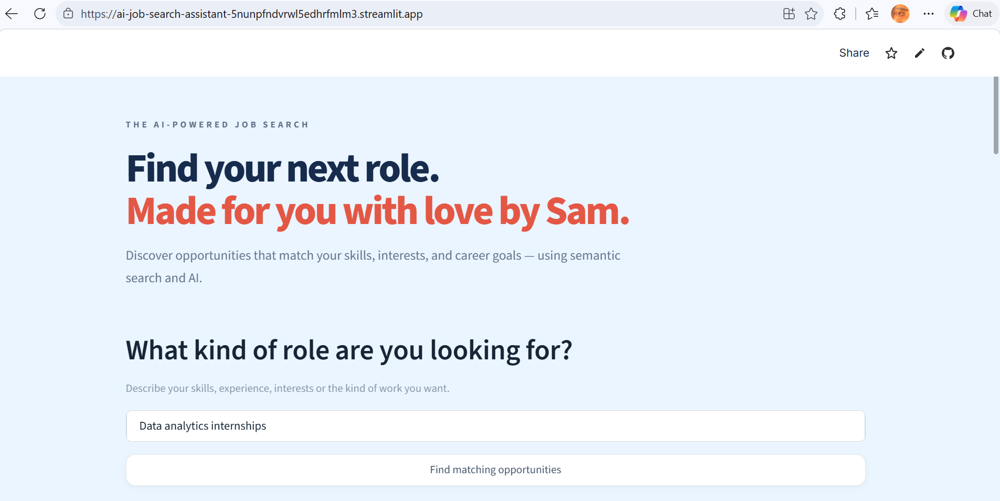
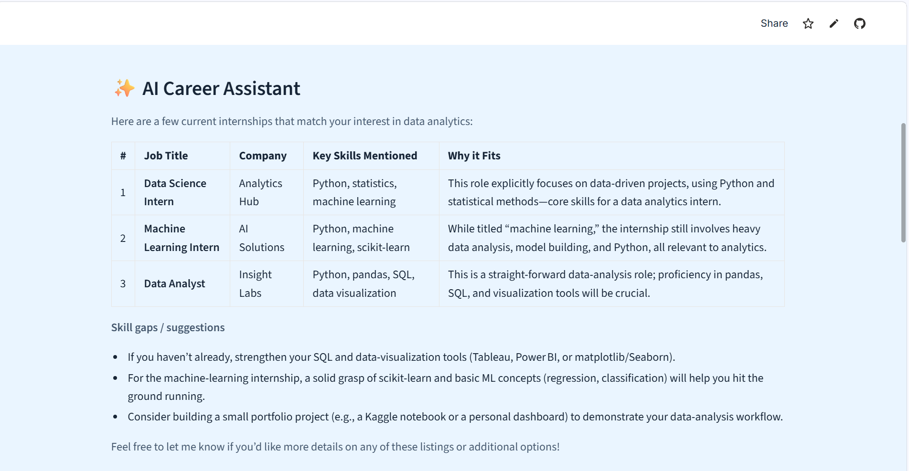
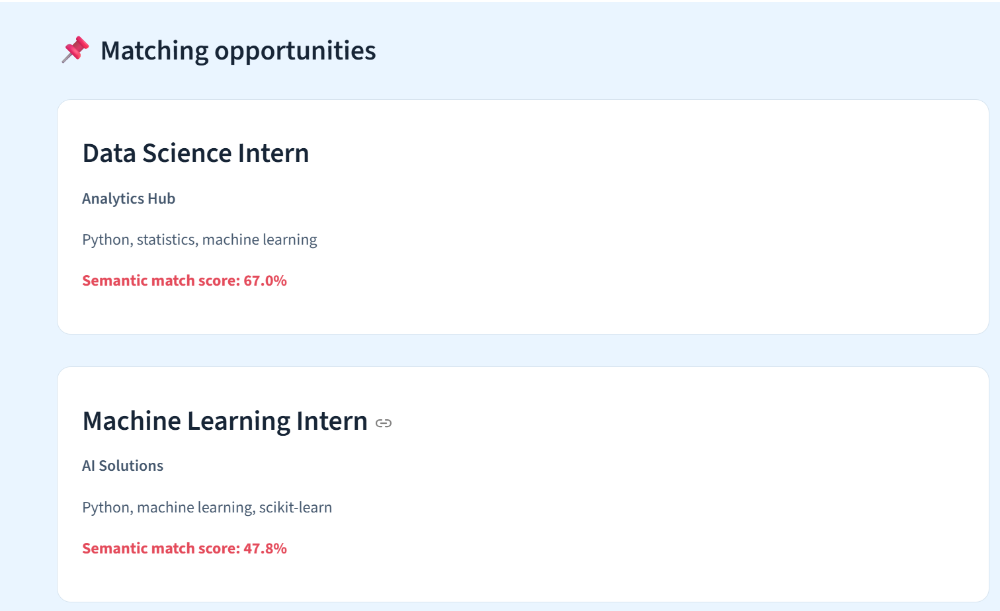
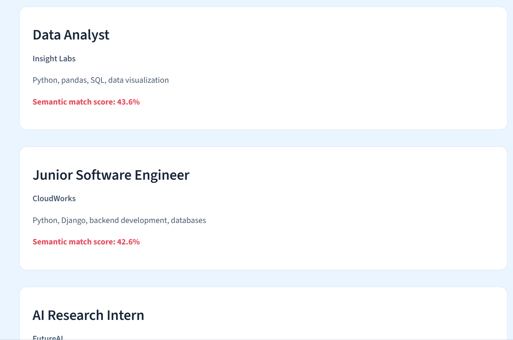

Sam's JobMatch AI Demo

AI-powered semantic job search assistant

Sam's JobMatch AI is an interactive job discovery application designed to help users find career opportunities that align with their skills, interests, experience, and career aspirations through natural-language queries and semantic search.

Instead of relying exclusively on exact keyword matches, the application aims to understand the intent behind a user’s search and identify relevant opportunities based on contextual similarity.

🚀 Live Demo

[(https://ai-job-search-assistant-5nunpfndvrwl5edhrfmlm3.streamlit.app/)]

💡 Problem Statement

Traditional job searches often require users to know the exact job title, keywords, or technical skills to search for. This can make discovering relevant opportunities difficult, particularly for candidates exploring interdisciplinary roles or unfamiliar career paths.

JobMatch AI aims to make job discovery more intuitive by allowing users to describe what they are looking for conversationally.

✨ Features

* Natural-language search: Describe your skills, interests, career goals, or desired roles in plain English.
* Semantic search: Retrieve opportunities based on contextual relevance rather than solely exact keyword matching.
* AI-powered search experience: Leverage language-model capabilities to improve the search experience.
* Interactive interface: A simple, user-friendly web application built with Streamlit.
* Relevant opportunity discovery: Explore roles across different career domains based on your query.

🛠️ Tech Stack

* Python
* Streamlit
* SQLite
* Groq API
* Semantic embeddings / vector-based similarity search

⚙️ How It Works

1. The user describes their career interests, skills, or desired opportunity in natural language.
2. The search system processes the query to capture its semantic meaning.
3. The query is compared against the available job data using semantic similarity.
4. Relevant opportunities are retrieved and presented through the application’s interface.

🖥️ Screenshots

## Application Preview
## Homepage

  

## Search Results

  
  
  

📂 Project Structure

JobMatch-AI/
├── samsapp.py
├── requirements.txt
└── README.md

🔧 Run Locally

Clone the repository:

git clone [(https://github.com/samandchandrasekhar/ai-job-search-assistant/tree/main)]
cd JobMatch-AI

Install dependencies:

pip install -r requirements.txt

Configure your Groq API key through Streamlit secrets.

Run the application:

streamlit run samsapp.py

🔮 Future Improvements

* Expand the job dataset and data sources.
* Actually run the command on hitting enter button
* Add filters for location, experience, job type, and industry.
* Improve relevance ranking and personalized recommendations.
* Add user profiles and saved opportunities.
* Incorporate additional career-path discovery capabilities.

👨‍💻 Author

Sam Chandrasekhar

Built as a personal project exploring AI-powered applications, semantic search, and accessible career discovery.
